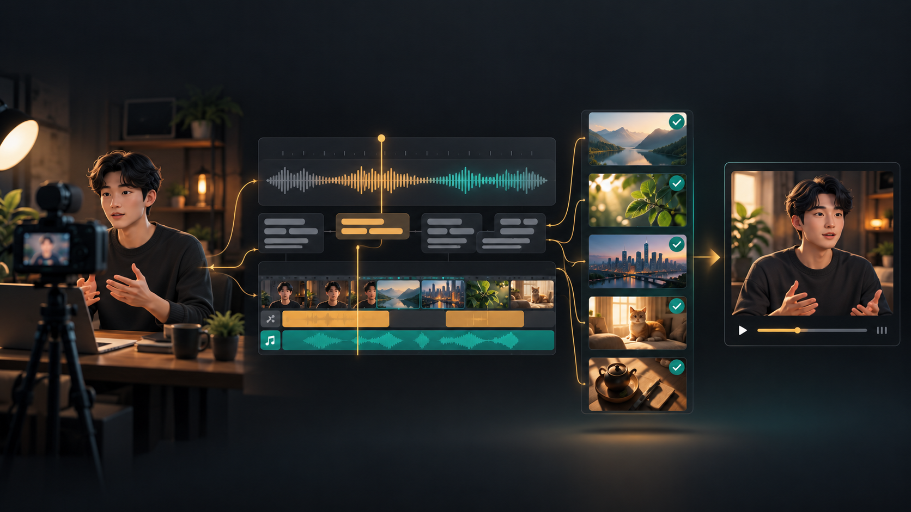
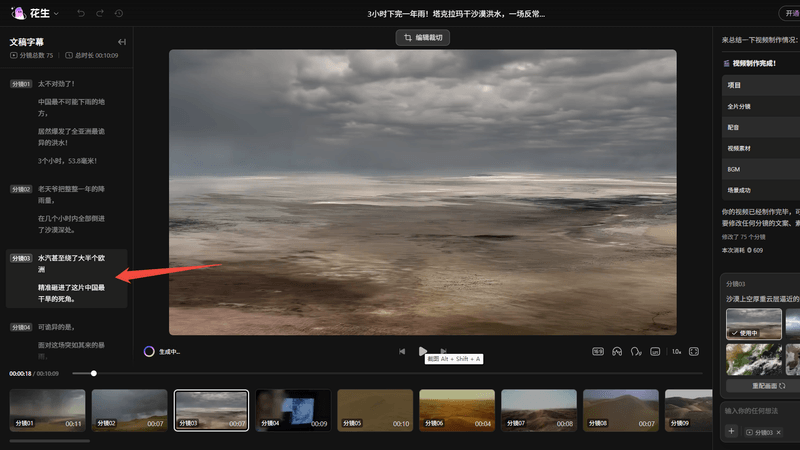

# AI Video Workflow CLI

> A local, batchable workflow for turning talking-head recordings into reviewed subtitles, B-roll rough cuts, and an evidence trail with Whisper and FFmpeg.



*Concept illustration of the local review workflow. It is an original visual asset for this repository, not a screenshot of any third-party product.*

## The marketing problem

For a creator or small content team, recording a talking-head video is usually not the expensive part. The repeated work after recording is:

- A promising hook remains buried in raw footage while subtitles are still pending.
- Editors spend too long finding B-roll, then cannot show where a clip came from or whether it supports the spoken claim.
- Campaigns need multiple variants, but subtitle fixes and visual replacement are repeated one video at a time.
- A promise, proof point, or CTA drifts during editing and loses clarity or trust.

The result is slower publishing, inconsistent creative, and a higher risk that the marketing message outruns its evidence.

`avwf` is an independent, local-first reference project inspired by the AI-assisted creation workflow associated with [Huasheng AI (花生 AI)](https://www.huasheng.cn/). It also uses a practical lesson from [Jianying (剪映)](https://www.capcut.cn/): an AI rough cut is useful only when a human can inspect and refine the underlying edit decisions. The CLI transcribes a batch of talking-head videos with Whisper, burns subtitles with FFmpeg, and can render a full-frame B-roll rough cut from **your own** asset catalog. Every proposed insert retains its source, tag match, licensing note, and source URL.

This project is not affiliated with Huasheng AI or Jianying. It does not use their brand assets or unpublished interfaces, and it is not an official SDK or API client.

### Product-workflow reference

The reference below is a Huasheng AI (花生 AI) workbench screenshot supplied from the repository owner's local product-material library. It illustrates the kind of scene-level subtitle and visual review workflow that informed this project's design; it is **not** an `avwf` interface or a claim of integration.



*Huasheng AI product-interface reference. The Huasheng AI name and interface remain the property of their respective owner.*

## Optimized for Chinese creator workflows

The project is written in English for global developer discoverability, but its content model is deliberately tuned for Chinese creator teams:

- **CJK-aware matching:** the B-roll matcher tokenizes Chinese phrases as well as Latin words, so catalog tags such as `剪辑`, `返工`, `口播`, `字幕`, and `完播率` can be matched against timed SRT captions.
- **Talking-head production flow:** it is designed around the common Chinese content workflow of `口播录制 → 字幕 → 素材/B-roll → 精修 → 发布`, rather than a generic stock-footage generator.
- **Local asset control:** creators can tag self-shot footage, licensed clips, screen recordings, and brand assets with rights notes and source URLs before they enter a rough cut.
- **Marketing review in context:** each caption stays beside its recommended visual so teams can inspect hooks, proof points, product claims, and CTAs before exporting.

## What it solves

- **Subtitle bottleneck:** turn recorded speech into timed SRT files and optionally burn captions into a review copy.
- **B-roll retrieval bottleneck:** match caption terms to approved assets instead of searching folders during every edit.
- **Marketing-message drift:** review the spoken line beside every suggested visual, hook, proof point, and CTA.
- **Trust gap:** export an auditable record of asset provenance and final editorial checks.

## What it improves beyond one-click editing

| Workflow layer | Reference pattern | `avwf` enhancement |
| --- | --- | --- |
| Speech to draft | Reduce the empty-timeline problem | Batch Whisper transcription produces reusable SRT files for every recording. |
| Words to visuals | Reduce material-matching work | B-roll is proposed only from a team-owned catalog with explicit, caption-level tag matches. |
| Draft to publish | Keep the creator in the loop | A JSON review record exposes the caption, insert time, source, and rights note before publishing. |
| One video to a campaign | Increase creative throughput | One command handles a folder of recordings, allowing hooks, proof points, and CTAs to be reviewed as a batch. |

## How it fits with Jianying-style finishing

[Jianying's official product page](https://www.capcut.cn/) presents text-based talking-head editing, material search, timeline work, and multi-camera editing. That class of editor is a sensible place to handle the last mile: pacing changes, visual emphasis, complex transitions, and final delivery.

`avwf` does not try to replicate Jianying or portray an automated rough cut as a final cut. It handles the earlier, easily neglected layer: structure the subtitles, proposed B-roll, source rights, marketing claims, and CTAs before the editor opens a timeline. The editor then receives an inspectable rough cut rather than an untraceable black-box output.

```text
talking-head recording
  → avwf batch transcription / B-roll review / rough cut
  → Jianying timeline refinement
  → evaluate Huasheng AI or another creation surface for the next production step
```

This is a division of work, not a product ranking: Jianying is a reference for hands-on finishing; Huasheng AI is a reference for script/audio-driven creation; `avwf` provides local batch processing, asset provenance, and marketing-content review.

## How to measure the effect

This repository does not claim a fixed lift in views or conversion. Those results depend on topic, audience, distribution, and creative quality. Instead, run a before/after pilot with ten comparable videos and track:

| Metric | Why it matters | Direction to test |
| --- | --- | --- |
| Recording-to-review lead time | Faster hooks can reach the publishing window sooner | Down |
| Subtitle correction minutes per video | Reveals whether the first draft is usable | Down |
| B-roll search minutes per video | Measures repeatable asset-retrieval work | Down |
| % of inserts with provenance | Makes visual proof and rights review auditable | Up |
| 3-second retention / average watch time | Tests whether hooks, captions, and visual pacing retain viewers | Up, validated in platform analytics |
| CTA click-through or qualified inquiry rate | Tests whether the message remains clear and credible | Up, validated in campaign analytics |

Keep the exported `broll-review.json` beside platform analytics. This connects an editing decision to an observable result instead of treating AI editing as a black box.

## Requirements

- Python 3.10+
- [FFmpeg](https://ffmpeg.org/) on `PATH`
- Whisper CLI on `PATH` for new transcription (`python -m pip install .[transcription]`)

No video is uploaded by this tool. Transcription and rendering run on the creator's machine.

## Quick start

```bash
python -m pip install -e ".[transcription]"

avwf batch recordings/ \
  --catalog examples/broll-catalog.csv \
  --output dist/ \
  --model base \
  --render-subtitles \
  --render-broll
```

For each `recordings/*.mp4`, the tool creates an SRT, an optional subtitled MP4, an optional full-frame B-roll rough cut, and a `broll-review.json` manifest. The rough cut only uses a local catalog entry when its tags match the spoken caption.

## B-roll catalog format

Use one CSV row per approved asset. Separate tags with `|`, using the terms your team actually says in scripts.

```csv
path,tags,rights_note,source_url
assets/subtitle-closeup.mp4,字幕|完播率|口播,Creator-owned footage,https://example.com/asset-log/subtitle-closeup
```

The tool proposes B-roll only when caption terms match approved tags. It deliberately leaves unmatched lines empty: a wrong visual is more damaging than a manual choice.

## Responsible marketing and EEAT

This project makes credible video marketing easier to review; it does not manufacture credibility.

- **Experience:** retain real spoken footage, caption timestamps, and asset logs from each campaign.
- **Expertise:** make subtitle and B-roll choices explicit and reproducible; let subject-matter reviewers change them.
- **Authoritativeness:** cite primary sources for claims in the script instead of using B-roll as implied proof.
- **Trust:** preserve asset rights notes, source URLs, sponsorship disclosures, and a human final check.

## Development

```bash
python -m pytest
```

Created by [phosphere33](https://github.com/phosphere33), a Tongji University media student documenting practical film and video technology workflows.
